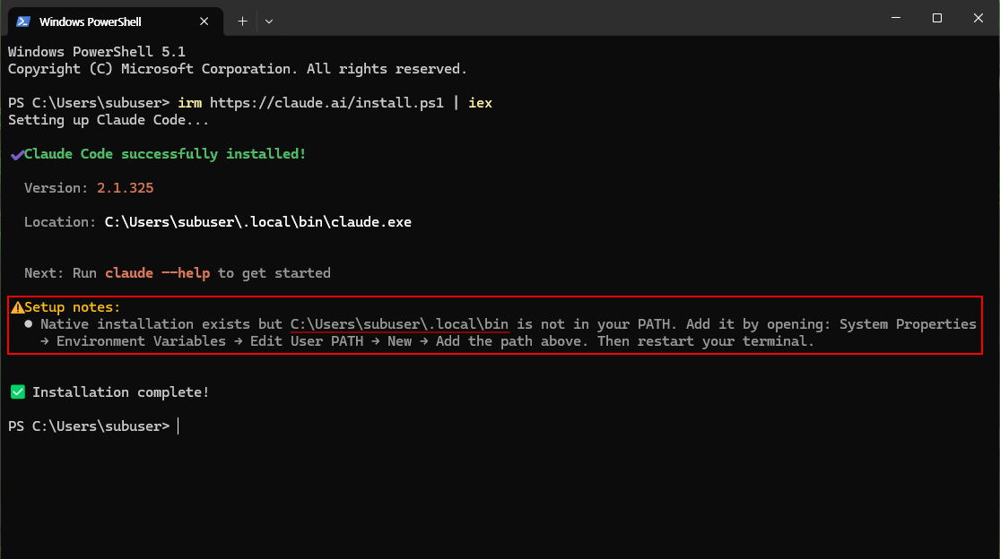
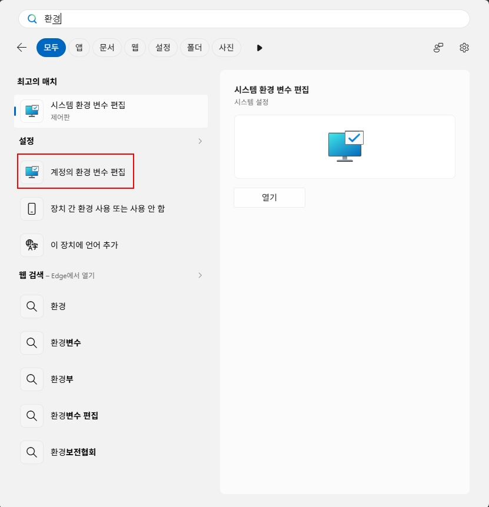
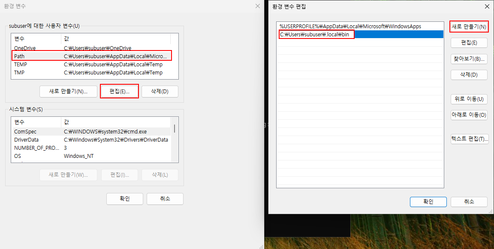
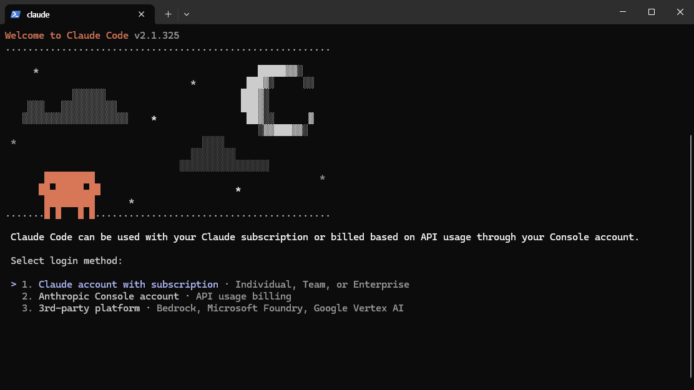
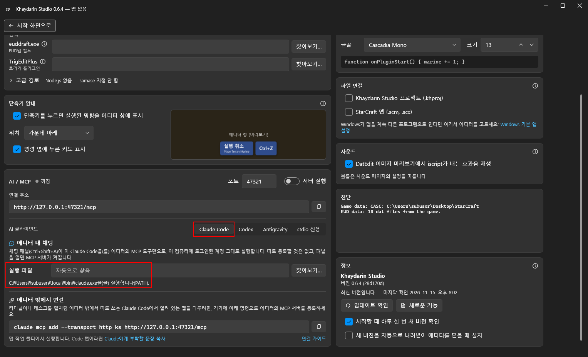
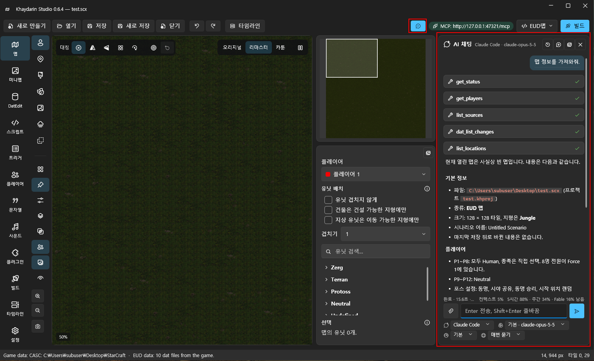

# Claude Code 연동 가이드

Khaydarin Studio의 `AI 채팅`에서 Claude Code를 사용하기 위한 설치·연동 방법을 안내합니다.  
이 가이드는 **Windows PowerShell**을 기준으로 설명합니다.

> **준비물**
> - Claude 구독 계정(Pro·Max·Team·Enterprise) 또는 Anthropic Console 계정
> - Khaydarin Studio

## 1. Claude Code 설치

시작 메뉴에서 `PowerShell`을 검색해 실행한 뒤, [Claude Code Quickstart 공식 문서](https://code.claude.com/docs/ko/quickstart)에 안내된 설치 명령어를 입력합니다.

```powershell
irm https://claude.ai/install.ps1 | iex
```



설치가 끝나면 `Claude Code successfully installed!` 메시지와 함께 `Setup notes`가 표시됩니다.  
설치 경로(`C:\Users\<사용자계정명>\.local\bin`)가 환경 변수 `PATH`에 등록되어 있지 않다는 안내이므로, 다음 단계에서 직접 등록해 줍니다.

> `Setup notes`가 보이지 않는다면 이미 PATH에 등록된 상태이므로 **3단계**로 넘어가도 됩니다.

## 2. 환경 변수(PATH) 등록



시작 메뉴에서 `환경`을 검색하면 `시스템 환경 변수 편집`과 `계정의 환경 변수 편집` 항목이 나타납니다.  
이 가이드에서는 **`계정의 환경 변수 편집`**을 사용합니다.



1. **사용자 변수** 목록에서 `Path`를 선택하고 **[편집]** 버튼을 클릭합니다.
2. **[새로 만들기]** 버튼을 클릭하고, 설치 화면에 표시된 경로를 붙여넣습니다.  
   (예: `C:\Users\<사용자계정명>\.local\bin`)
3. **[확인]**을 눌러 열려 있는 창을 모두 닫아 저장합니다.

## 3. 로그인

환경 변수는 새로 연 터미널에만 적용됩니다. **PowerShell을 닫았다가 다시 실행**한 뒤 아래 명령어를 입력합니다.

```powershell
claude
```



로그인 방식을 고르는 화면이 나타나면 사용 중인 계정에 맞는 방식을 선택해 로그인을 진행합니다.

- **Claude account with subscription** — Claude Pro·Max·Team·Enterprise 구독 계정
- **Anthropic Console account** — API 사용량 기반 과금 계정

브라우저에서 로그인을 마치고 터미널에 Claude Code 화면이 뜨면 설치는 끝입니다. PowerShell은 닫아도 됩니다.

## 4. Khaydarin Studio에서 연결 확인



Khaydarin Studio를 실행하고 **설정**으로 이동합니다.

1. `AI / MCP` 영역의 **AI 클라이언트**에서 **Claude Code** 탭을 선택합니다.
2. **실행 파일** 아래에 `C:\Users\<사용자계정명>\.local\bin\claude.exe을(를) 실행합니다(PATH).` 처럼 경로가 표시되는지 확인합니다.

> 경로가 표시되지 않는다면 Khaydarin Studio를 완전히 종료했다가 다시 실행해 보세요. 그래도 잡히지 않으면 **[찾아보기...]** 버튼으로 `claude.exe`를 직접 지정할 수 있습니다.

## 5. AI 채팅으로 테스트



맵을 하나 새로 만들거나 열고, 상단의 채팅 버튼(또는 `Ctrl+Shift+A`)으로 `AI 채팅` 패널을 엽니다.  
`맵 정보를 가져와줘.`처럼 메시지를 보냈을 때, 위 화면처럼 `get_status` 등의 도구가 실행되고 맵 정보가 답변으로 돌아오면 연동이 완료된 것입니다.

---

### 참고: 에디터 밖에서 Claude Code 연결하기

터미널이나 데스크톱 앱처럼 에디터 밖에서 쓰는 Claude Code로 열려 있는 맵을 다루고 싶다면, 맵 작업 폴더에서 아래 명령어로 에디터의 MCP 서버를 등록합니다.  
(설정의 `AI / MCP` 영역에서 **서버 실행**이 켜져 있어야 합니다.)

```powershell
claude mcp add --transport http ks http://127.0.0.1:47321/mcp
```

포트를 바꿨다면 설정 화면의 **연결 주소**에 표시된 값을 사용하세요.
