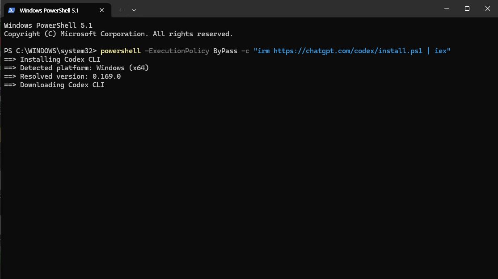
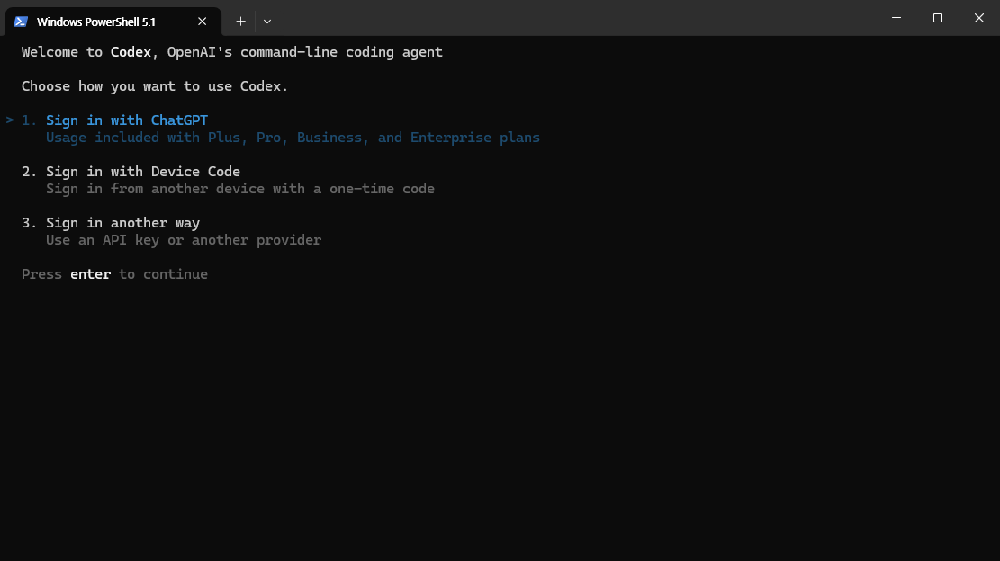
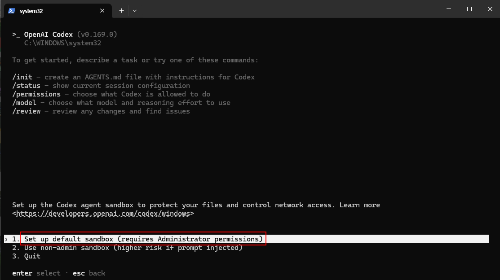
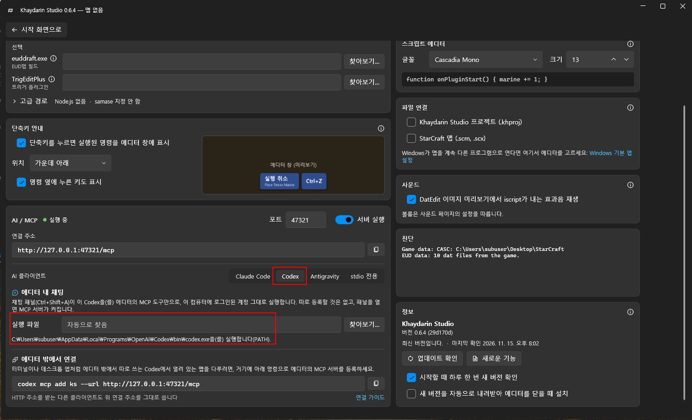
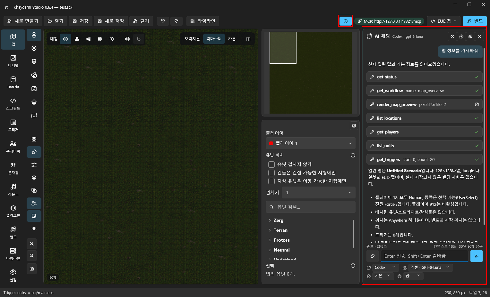

# Codex 연동 가이드

Khaydarin Studio의 `AI 채팅`에서 OpenAI Codex를 사용하기 위한 설치·연동 방법을 안내합니다.  
이 가이드는 **Windows PowerShell**을 기준으로 설명합니다.

> **준비물**
> - ChatGPT 구독 계정(Plus·Pro·Business·Enterprise) 또는 OpenAI API 키
> - Khaydarin Studio

## 1. Codex CLI 설치

시작 메뉴에서 `PowerShell`을 검색해 실행한 뒤, [Codex CLI 공식 문서](https://learn.chatgpt.com/docs/codex/cli)에 안내된 설치 명령어를 입력합니다.

```powershell
powershell -ExecutionPolicy ByPass -c "irm https://chatgpt.com/codex/install.ps1 | iex"
```



`Installing Codex CLI` → `Downloading Codex CLI` 순서로 설치가 진행됩니다. 설치가 끝날 때까지 기다려 주세요.

## 2. 로그인

설치가 끝나면 **PowerShell을 닫았다가 다시 실행**한 뒤 아래 명령어를 입력합니다.

```powershell
codex
```

> `codex`를 찾을 수 없다는 오류가 나온다면, [Claude Code 가이드의 2단계](../claude/guide.md#2-환경-변수path-등록)와 같은 방법으로 `C:\Users\<사용자계정명>\AppData\Local\Programs\OpenAI\Codex\bin` 경로를 환경 변수 `Path`에 추가한 뒤 PowerShell을 다시 실행하세요.



로그인 방식을 고르는 화면이 나타나면 사용 중인 계정에 맞는 방식을 선택해 로그인을 진행합니다.

- **Sign in with ChatGPT** — ChatGPT Plus·Pro·Business·Enterprise 구독 계정 (일반적으로 이 방식을 사용합니다)
- **Sign in with Device Code** — 다른 기기에서 일회용 코드로 로그인
- **Sign in another way** — API 키 또는 다른 제공자 사용

## 3. 샌드박스 설정



로그인을 마치면 Codex가 파일과 네트워크 접근을 제한하는 **샌드박스**를 설정할지 묻습니다.  
**`1. Set up default sandbox`**를 선택하는 것을 권장합니다. 관리자 권한을 요청하는 창이 뜨면 **[예]**를 눌러 허용합니다.

> 관리자 권한을 줄 수 없는 환경이라면 `2. Use non-admin sandbox`를 선택해도 됩니다. 다만 프롬프트 인젝션 같은 공격에 상대적으로 취약해집니다.  
> 자세한 내용은 [Codex Windows 공식 문서](https://developers.openai.com/codex/windows)를 참고하세요.

설정이 끝나고 Codex 화면이 뜨면 설치는 끝입니다. PowerShell은 닫아도 됩니다.

## 4. Khaydarin Studio에서 연결 확인



Khaydarin Studio를 실행하고 **설정**으로 이동합니다.

1. `AI / MCP` 영역의 **AI 클라이언트**에서 **Codex** 탭을 선택합니다.
2. **실행 파일** 아래에 `C:\Users\<사용자계정명>\AppData\Local\Programs\OpenAI\Codex\bin\codex.exe을(를) 실행합니다(PATH).` 처럼 경로가 표시되는지 확인합니다.

> 경로가 표시되지 않는다면 Khaydarin Studio를 완전히 종료했다가 다시 실행해 보세요. 그래도 잡히지 않으면 **[찾아보기...]** 버튼으로 `codex.exe`를 직접 지정할 수 있습니다.

## 5. AI 채팅으로 테스트



맵을 하나 새로 만들거나 열고, 상단의 채팅 버튼(또는 `Ctrl+Shift+A`)으로 `AI 채팅` 패널을 엽니다.  
패널 하단의 클라이언트 선택이 **Codex**로 되어 있는지 확인한 뒤 `맵 정보를 가져와줘.`처럼 메시지를 보내봅니다.  
위 화면처럼 `get_status` 등의 도구가 실행되고 맵 정보가 답변으로 돌아오면 연동이 완료된 것입니다.

---

### 참고: 에디터 밖에서 Codex 연결하기

터미널이나 데스크톱 앱처럼 에디터 밖에서 쓰는 Codex로 열려 있는 맵을 다루고 싶다면, 아래 명령어로 에디터의 MCP 서버를 등록합니다.  
(설정의 `AI / MCP` 영역에서 **서버 실행**이 켜져 있어야 합니다.)

```powershell
codex mcp add ks --url http://127.0.0.1:47321/mcp
```

포트를 바꿨다면 설정 화면의 **연결 주소**에 표시된 값을 사용하세요.
