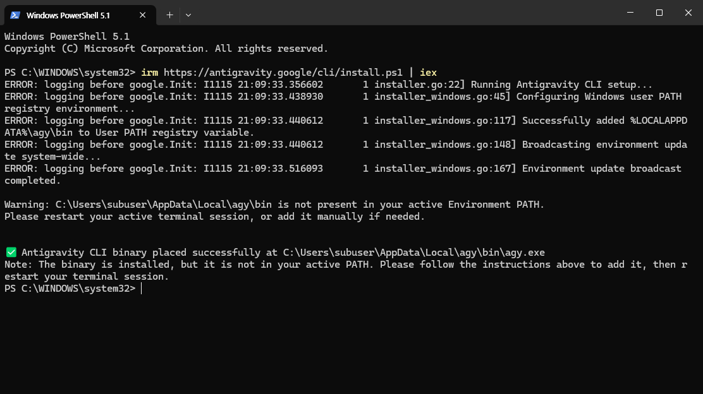
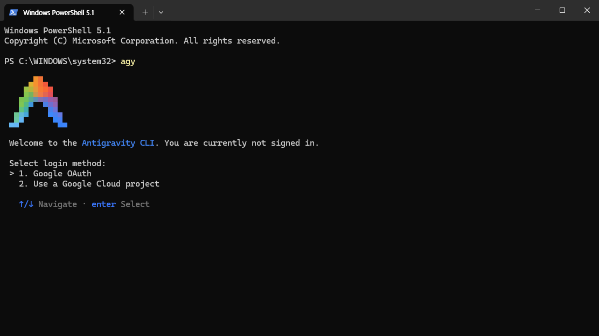
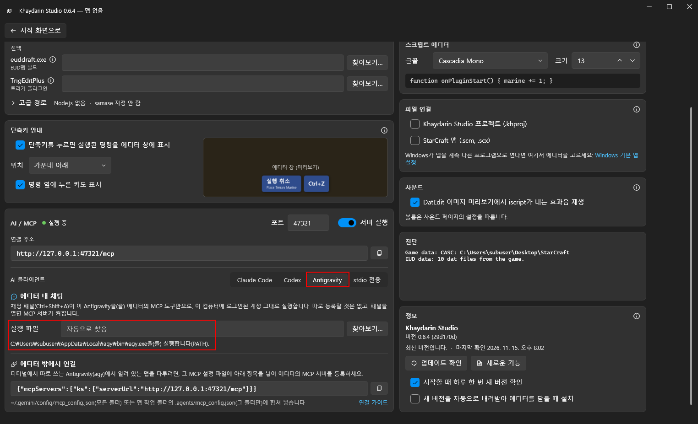
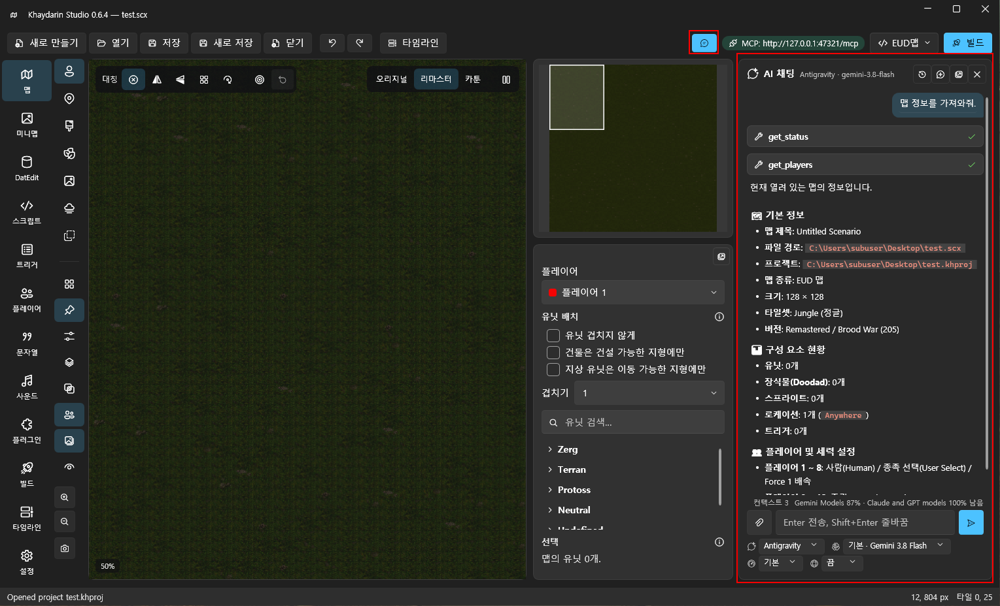

# Antigravity (Gemini) 연동 가이드

Khaydarin Studio의 `AI 채팅`에서 Google Antigravity CLI(Gemini)를 사용하기 위한 설치·연동 방법을 안내합니다.  
이 가이드는 **Windows PowerShell**을 기준으로 설명합니다.

> **준비물**
> - Google 계정 (또는 Google Cloud 프로젝트)
> - Khaydarin Studio

## 1. Antigravity CLI 설치

시작 메뉴에서 `PowerShell`을 검색해 실행한 뒤, [Antigravity CLI 공식 다운로드 페이지](https://antigravity.google/download#antigravity-cli)에 안내된 설치 명령어를 입력합니다.

```powershell
irm https://antigravity.google/cli/install.ps1 | iex
```



마지막에 `Antigravity CLI binary placed successfully` 메시지가 나오면 설치가 끝난 것입니다.

> 설치 중 `ERROR: logging before google.Init` 으로 시작하는 줄이 여러 개 보이지만, 실제 오류가 아닌 **진행 로그**이므로 무시해도 됩니다.

설치 프로그램이 `C:\Users\<사용자계정명>\AppData\Local\agy\bin` 경로를 환경 변수 `PATH`에 **자동으로 등록**해 줍니다.  
다만 지금 열려 있는 PowerShell에는 아직 반영되지 않았다는 `Warning`/`Note`가 표시되므로, 다음 단계에서 PowerShell을 다시 실행합니다.

## 2. 로그인

**PowerShell을 닫았다가 다시 실행**한 뒤 아래 명령어를 입력합니다.

```powershell
agy
```

> `agy`를 찾을 수 없다는 오류가 나온다면, [Claude Code 가이드의 2단계](../claude/guide.md#2-환경-변수path-등록)와 같은 방법으로 `C:\Users\<사용자계정명>\AppData\Local\agy\bin` 경로를 환경 변수 `Path`에 직접 추가한 뒤 PowerShell을 다시 실행하세요.



로그인 방식을 고르는 화면이 나타나면 사용 중인 계정에 맞는 방식을 선택해 로그인을 진행합니다.

- **Google OAuth** — 개인 Google 계정으로 로그인 (일반적으로 이 방식을 사용합니다)
- **Use a Google Cloud project** — Google Cloud 프로젝트로 로그인

브라우저에서 로그인을 마치고 터미널에 Antigravity CLI 화면이 뜨면 설치는 끝입니다. PowerShell은 닫아도 됩니다.

## 3. Khaydarin Studio에서 연결 확인



Khaydarin Studio를 실행하고 **설정**으로 이동합니다.

1. `AI / MCP` 영역의 **AI 클라이언트**에서 **Antigravity** 탭을 선택합니다.
2. **실행 파일** 아래에 `C:\Users\<사용자계정명>\AppData\Local\agy\bin\agy.exe을(를) 실행합니다(PATH).` 처럼 경로가 표시되는지 확인합니다.

> 경로가 표시되지 않는다면 Khaydarin Studio를 완전히 종료했다가 다시 실행해 보세요. 그래도 잡히지 않으면 **[찾아보기...]** 버튼으로 `agy.exe`를 직접 지정할 수 있습니다.

## 4. AI 채팅으로 테스트



맵을 하나 새로 만들거나 열고, 상단의 채팅 버튼(또는 `Ctrl+Shift+A`)으로 `AI 채팅` 패널을 엽니다.  
패널 하단의 클라이언트 선택이 **Antigravity**로 되어 있는지 확인한 뒤 `맵 정보를 가져와줘.`처럼 메시지를 보내봅니다.  
위 화면처럼 `get_status` 등의 도구가 실행되고 맵 정보가 답변으로 돌아오면 연동이 완료된 것입니다.

---

### 참고: 에디터 밖에서 Antigravity 연결하기

터미널에서 따로 쓰는 Antigravity(`agy`)로 열려 있는 맵을 다루고 싶다면, MCP 설정 파일에 아래 항목을 넣어 에디터의 MCP 서버를 등록합니다.  
(설정의 `AI / MCP` 영역에서 **서버 실행**이 켜져 있어야 합니다.)

```json
{"mcpServers":{"ks":{"serverUrl":"http://127.0.0.1:47321/mcp"}}}
```

- 모든 폴더에서 사용: `~/.gemini/config/mcp_config.json`
- 특정 맵 작업 폴더에서만 사용: 해당 폴더의 `.agents/mcp_config.json`

파일에 이미 다른 내용이 있다면 덮어쓰지 말고 `mcpServers` 안에 `ks` 항목만 합쳐 넣으세요. 포트를 바꿨다면 설정 화면의 **연결 주소**에 표시된 값을 사용하세요.
